# 分集详解 P1–P19

> 这是**详细版**：每集分「视频里做了什么 / 我实现了什么 / 关键代码 / 踩坑与取舍 / 怎么验证 / 与视频的差异」六段。
> 速览版（P1–P25 全景）见 [`分集说明.md`](分集说明.md)。
>
> 工程：`D:\deepseek工作区\deck-builder-game`
> 引擎：Godot **4.7.2**（视频用 4.1 / 4.3）
> 素材：`guladam/deck_builder_tutorial` 的 `season-1-starter-project` 分支（Kenney Tiny Dungeon）
> 视口：256×144，窗口 1280×720，最近邻采样

---

## 阅读前必看：这份重建的诚实边界

| 集 | 视频我看到了什么程度 |
|---|---|
| P1、P2 | **逐段分镜 + 抽原生帧**，节点树、编辑操作、代码都核对过 |
| P4、P7 | 抽中间帧确认（P4 的 `CardDropArea` / `Hand→CardUI` 树；P7 的 `player.gd` 信号绑定原文） |
| P3、P5、P6、P8–P19 | **没有逐帧看**：按分集标题 + 原作成品仓库（`season-1-code` 分支）的结构实现，行为靠自测脚本断言 |

所以下面写着「视频里」的部分，P1/P2/P4/P7 是从画面读出来的；其余是根据标题和成品仓库推断的**意图**，不是逐字台词。凡是推断，我会标「（据标题推断）」。

另外有三处**分集归并**，先讲清楚，免得对不上：

1. **P9 / P10 我是合着做的**。P9「法力 UI 与效果」和 P10「打出与禁用」在代码上是同一块（扣能量→执行效果→进弃牌堆→能量不够退回），拆开做只会来回改同一个函数。
2. **受击闪白我放在了 P17**（「战斗手感打磨」），因为 P9 的真实主题是法力与效果，不是打击感。
3. **P6 的数据层一次建全**（Card / CardPile / Stats / Effect），后面每集只是往上加字段。

> 各集「怎么验证」里贴的自检输出，是**当时那一步跑出来的**。自检脚本（`tools/feature_test.gd`）随阶段演进了好几轮，现在跑它会打印 P21–P25 的内容。想复现某一集的验证，看对应的截图更准（`shots/` 里全部保留）。

---

## 总览

| 集 | 时长 | 视频标题 | 这一集的产出 | 主要文件 |
|---|---|---|---|---|
| P1 | 9:26 | 项目创建、背景场景与像素画质优化 | 工程配置 + 背景 | `project.godot`、`scenes/battle/battle.tscn` |
| P2 | 25:10 | 卡牌拖拽机制：从状态机设计到鼠标交互 | CardUI + 状态机 + 手牌 | `scenes/card_ui/*`、`scenes/ui/hand.tscn` |
| P3 | 25:04 | 悬停判定与释放逻辑 | 悬停放大、松手落点 | `card_base_state.gd`、`card_released_state.gd` |
| P4 | 20:52 | 瞄准敌人和弧线指引 | 弧线选择器 | `scenes/card_target_selector/*` |
| P5 | 21:25 | 瞄准系统：瞄准状态、弧线、目标选择 | AIMING 状态 + 命中 | `card_aiming_state.gd` |
| P6 | 19:41 | Cardpile 与 Stats：数据驱动架构 | 全部 Resource | `custom_resources/*.gd` |
| P7 | 23:46 | Stats UI：血量格挡、属性绑定、信号更新 | 数值 UI | `scenes/ui/stats_ui.*` |
| P8 | 20:02 | 卡牌视觉重构：鼠标过滤、资源驱动 UI | 卡面 | `card_ui.tscn`、`card_ui.gd` |
| P9 | 20:06 | 法力 UI 与效果：伤害格挡、打出逻辑 | 能量、效果执行 | `player.gd`、`custom_resources/*_effect.gd` |
| P10 | 21:00 | 打出与禁用系统：法力判断、交互拦截 | 能量校验、取消回位 | `battle.gd`、`card_ui.gd` |
| P11 | 18:55 | 卡牌悬浮提示与交互优化 | 提示框、不可负担态 | `scenes/ui/card_tooltip.*` |
| P12 | 19:07 | 回合管理与抽牌：依赖注入、PlayerHandler、Tween | 牌堆抽出、逐张抽牌 | `scenes/player/player_handler.gd` |
| P13 | 19:45 | 结束回合与弃牌：按钮 UI、弃牌动画、洗牌堆 | 回合闭环 | `player_handler.gd`、`battle.gd` |
| P14 | 23:38 | 敌人 AI：条件概率动作、权重随机、补间 | 动作表 + 抽签 | `custom_resources/enemy_action.gd`、`enemy_ai.gd` |
| P15 | 23:14 | AI 接入与战斗闭环：序列执行、胜负判定 | 意图→执行→胜负 | `enemy.gd`、`battle.gd` |
| P16 | 24:55 | 敌人意图系统：Intent 资源、UI 显示 | 意图 UI | `scenes/ui/intent_ui.*` |
| P17 | 29:57 | 战斗手感：震动、闪白、红屏 | 三件套 | `global/shaker.gd` |
| P18 | 27:34 | 音效音乐与战斗结算 | 全局音效 | `global/sfx.gd` |
| P19 | 30:58 | 胜利失败面板 + 暂停 | 结算与暂停 | `scenes/ui/battle_over_panel.*` |


## 截图索引

所有截图在工程根目录的 shots/ 下，_big 是放大 3 倍的版本。

| 集 | 截图 | 看图看什么 |
|---|---|---|
| P1 | `p3_1_base_big.png` | 背景只有一层 Sprite2D |
| P2 | `p3_2_dragging_big` / `p3_4_played_big` | 拖动中 vs 打出后 |
| P3 | `p3_2_dragging_big` / `p3_3_returned_big` | 落点在区外 → 卡回手牌 |
| P4 | `p10_2_aiming_big` / `r11_aim_big` | 修好前 / 修好后的弧线 |
| P5 | `r11_aim_big` / `p10_3_after_strike_big` | 瞄准态 → 打中 |
| P6 | `p10_1_battle_big` / `p24_card_menu_big` | 战斗 + 同一批 Card 复用 |
| P7 | `p26_topbar_big` / `s_block_big` | 数值显示 + 格挡 5 |
| P8 | `p24_card_menu_big` / `p11_tooltip_big` | 卡面 + 提示文字同源 |
| P9 | `p10_3_after_strike_big` / `s_block_big` | 伤害效果 / 格挡效果 |
| P10 | `p11_unaffordable_big` / `p26_topbar_big` | 能量不足 vs 正常 |
| P11 | `p11_tooltip_big` / `p11_unaffordable_big` | 提示框 + 不可负担态 |
| P12 | `s_drawing_big` / `p12_after_play_big` | 逐张抽牌 / 打出之后 |
| P13 | `p13_pile_view_big` / `p17_turn_big` | 牌堆查看 / 回合切换 |
| P14 | `p16_intents_big` / `p17_turn_big` | 意图 / 执行 |
| P15 | `p17_turn_big` / `s_defeat_big` | 敌人执行 → 失败面板 |
| P16 | `p16_intents_big` / `p26_topbar_big` | 意图上色 + 整体界面 |
| P17 | `p19_victory_big` / `s_defeat_big` | 震屏抓不到，看它作用的界面 |
| P18 | `p10_1_battle_big` / `s_relics_big` | 音效挂载的场景 / Run 中枢 |
| P19 | `p19_victory_big` / `s_defeat_big` / `s_pause_big` | 胜 / 负 / 暂停 |

---

# P1 · 项目创建、背景场景与像素画质优化（9:26）

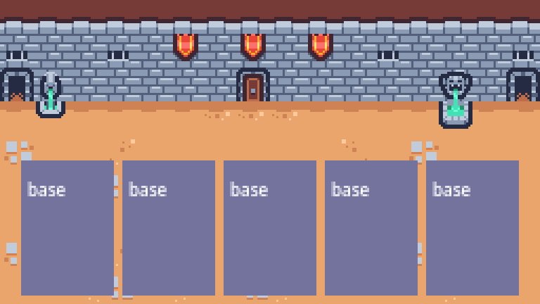

> 只有一层 Sprite2D：墙砖 + 棕色地面，没有任何 UI

## 视频里

1. **0:00–1:25 演示成品**：35 血战士对两只小怪 + 一只 12 血厚怪；手牌在右下角；`End Turn`；抽牌堆显示 `1/3`；打出 `Deal 4 damage to all enemies` 和 `Gain 5 block`；清场弹 `Victorious!`。
2. **1:25–4:30 讲架构**（这集最值钱的部分，是这一集真正在教的东西）：
   - `Battle` 管回合、胜败条件
   - `EnemyHandler` 管敌人回合、触发敌人行动
   - `PlayerHandler` 管玩家回合、拖拽出牌
   - `Player` 显示数值、表现伤害
   - 数据用 Resource：`Card`（cost/effect）、`CardPile`、`Effect`、`Stats → CharacterStats / EnemyStats`
3. **4:30** 去找配套工程；**4:45** 感谢 Kenney 的 Tiny Dungeon 素材；**4:52** 新建工程 `deck builder game`，开 Git 版本控制。
4. **5:00–9:25** 导入素材、把默认纹理过滤改成 Nearest、铺墙和地面背景。

## 我实现了什么

- `project.godot`：256×144 视口、窗口 1280×720、`stretch/mode="viewport"`、最近邻采样、Mobile 渲染器
- `scenes/battle/battle.tscn`：`Sprite2D` + `background.png`，`centered = false`

```ini
[display]
window/size/viewport_width=256
window/size/viewport_height=144
window/size/window_width_override=1280
window/size/window_height_override=720
window/stretch/mode="viewport"

[rendering]
textures/canvas_textures/default_texture_filter=0   ; 0 = Nearest
renderer/rendering_method="mobile"
```

**为什么是 256×144**：素材是 16×16 的像素 tile，256 宽正好 16 格；放大 5 倍到 1280 是整数倍，不会出现半像素糊边。

## 踩坑与取舍

- 视频用 Godot **4.1/4.3**，本机是 **4.7.2**。`config/features` 我按 4.7 写；4.x 之间场景格式兼容，但 GDScript 的少量 API 有差异（后面几集碰到再改）。
- 视频里最后画面是「墙 + 地」两层贴图拼的；实际 `background.png` 本身就是一张 256×144 的合成图，一层 `Sprite2D` 就够。

## 怎么验证

```powershell
& "...\Godot_v4.7.2-stable_win64.exe" --path "D:\deepseek工作区\deck-builder-game"
```

画面应该就是墙砖 + 棕色地面，没有任何 UI。

## 与视频的差异

无实质差异。唯一区别是视频里工程名带空格（`deck builder game`），我这里也保留了同样的名字。

---

# P2 · 卡牌拖拽机制：从状态机设计到鼠标交互（25:10）

|  |  |
| :---: | :---: |
| 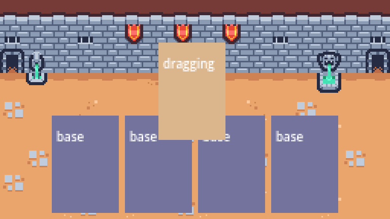 | 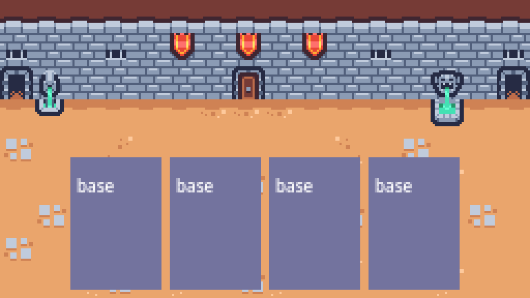 |

> 左：拖出来的卡跟着鼠标走，卡上写着状态名（当时用调试配色区分状态）　右：松手打出后，卡消失、敌人掉血

## 视频里

1. **0:00–1:30** 演示：卡牌拖动、多张卡叠在一起、松手打出、敌人掉血。
2. **1:52** 新建场景，根节点选 `User Interface`（即 `Control`），改名 `CardUI`。
   （抽帧字幕：「也就是 Control 控制节点，选中后重命名为 Card UI」）
3. **2:05** 加 `ColorRect`——字幕原话：「也就是各状态的视觉效果，方便调试」。
4. **2:28** 加 `Label`，用来显示当前状态名。
5. **4:13** 反复换颜色试状态。
6. **9:00 状态机图**（本集核心）：

```
base ──左键──> clicked ──移动──> dragging ──松开──> released ──> base
```

7. **11:00** 用 `HBoxContainer` 做 `Hand` 手牌区。
8. **15:00–25:00** 写状态机与各状态脚本。

## 我实现了什么

```
CardUI (Control 40×56)
├── Background (ColorRect)      ← P2 时是调试色块，P8 换成卡面
├── State (Label)               ← P2 时显示状态名，P8 移除
└── CardStateMachine (Node)
    ├── Base     (state = 0)
    ├── Clicked  (state = 1)
    ├── Dragging (state = 2)
    └── Released (state = 3)
```

**状态机本体**（`card_state_machine.gd`）只做三件事：谁是当前、切过去、把输入转给当前。

```gdscript
func transition_to(next: CardState) -> void:
	if next == null or next == current_state:
		return
	if current_state:
		current_state.exit()
	current_state = next
	next.enter()
	next.post_enter()
	state_changed.emit(NAMES.get(next.state, "?"))


func _on_transition_requested(from: CardState, to: CardState.State) -> void:
	# 迟到的请求直接丢掉：避免"已经松手了，延迟的拖动请求又把卡拽走"
	if from != current_state:
		return
	var next: CardState = states.get(to)
	if next:
		transition_to(next)
```

**每个状态一个文件**，进入/退出各管自己的事：

```gdscript
# card_dragging_state.gd
func enter() -> void:
	card_ui.remember_home()          # 记下原位（弧线起点 / 松手回位都用它）
	var ui_layer := get_tree().get_first_node_in_group("ui_layer")
	if ui_layer and card_ui.get_parent() != ui_layer:
		card_ui.reparent(ui_layer)   # 必须搬出 HBoxContainer
	card_ui.z_index = 100
	set_process(true)
```

## 踩坑与取舍

**坑 1：卡拖不动。** 卡留在 `HBoxContainer` 里时，容器每帧都会把子节点的位置改回布局结果，`position` 赋值立刻被覆盖。必须 `reparent()` 到一个不受布局管理的节点（`CanvasLayer` 下面的 `UILayer`），松手再搬回去。

**坑 2：`transition_to` 的缩进（我自己的 bug）。** 第一版把整段逻辑误包进了 `if current_state:` 里：

```gdscript
func transition_to(next: CardState) -> void:
	if next == null or next == current_state:
		return
	if current_state:
		current_state.exit()
		current_state = next      # ← 全都在 if 里面
		next.enter()
	...
```

后果是**第一次切换永远不生效**（此时 `current_state` 还是 null），卡永远停在未初始化状态，`current_state_name()` 返回 `?`。定位方式是加打印，看到 `init` 被调了、`states` 也填好了，但 `current_state` 仍是 `<null>`。

**取舍：为什么每个状态单独一个文件。** 也可以写成一个 `match state:` 的大函数，但状态一多（P5 还要加 `AIMING`）那个函数会变成几百行。拆文件后加状态只需新增一个 `.gd` + 一行 `state = N`。

## 怎么验证

```powershell
& "...\Godot_v4.7.2-stable_win64.exe" --path "...\deck-builder-game" res://tools/feature_test.tscn
```

自检里会跑 `base → clicked → dragging → released` 并打印 `current_state_name()`。

## 与视频的差异

- 视频的 `CardUI` 尺寸更大（约 56×80），我用 40×56，因为 5 张卡 × 56 会超出 256 宽。
- 视频后面会把 `CardUI` 拆成 `CardUI` + `CardVisuals` 两层（P8 附近）；我这里保持单层，卡面直接挂在 `CardUI` 下。

---

# P3 · 卡牌拖拽中的悬停判定与释放逻辑（25:04）

|  |  |
| :---: | :---: |
|  | 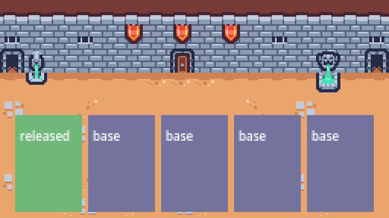 |

> 左：拖到一半（dragging，米色）　右：落在出牌区外松手，卡回到手牌（released，绿色）

## 视频里（据标题推断）

- 鼠标进入卡牌要放大/提亮，离开要还原
- 松手时判断「这张卡算不算打出去」：落在出牌区才算，落回别处就退回手牌

## 我实现了什么

**悬停**（`card_base_state.gd`）：

```gdscript
const HOVER_SCALE := 1.12

func on_mouse_entered() -> void:
	card_ui.z_index = 5
	_scale_to(Vector2.ONE * CardUI.HOVER_SCALE)

func _scale_to(target: Vector2) -> void:
	if _hover_tween and _hover_tween.is_valid() and _hover_tween.is_running():
		_hover_tween.kill()
	_hover_tween = card_ui.create_tween()
	_hover_tween.set_trans(Tween.TRANS_QUAD).set_ease(Tween.EASE_OUT)
	_hover_tween.tween_property(card_ui, "scale", target, 0.08)
```

**松手**（`card_released_state.gd`）：

```gdscript
if card_ui.card == null:
	_return_home(); return

var targets: Array = []
if card_ui.card.is_single_targeted():
	targets = card_ui.targets_under_mouse()
	if targets.is_empty():
		_return_home()      # 没瞄到人 → 取消
		return
elif not card_ui.is_over_play_zone():
	_return_home(); return

card_ui.request_play(targets)   # 交给 battle 结算
```

**回位**按 `original_index` 插回去，不是简单 `add_child`（否则卡会跑到队尾）：

```gdscript
var last := card_ui.original_parent.get_child_count() - 1
card_ui.original_parent.move_child(card_ui, mini(card_ui.original_index, last))
```

## 踩坑与取舍

**坑（事后才发现）：悬停其实一直没生效。** `CardUI` 的 `mouse_entered` 转给了 `state_machine.on_mouse_entered()`，但状态机里根本没有这个方法——GDScript 里调用不存在的方法会报错但不中断流程，所以拖动一切正常，只有悬停放大静默失效。这个问题一直到 **P11** 加提示框时才被发现并修掉（给状态机补了 `on_mouse_entered/on_mouse_exited` 转发 + 给 `CardState` 补了空实现）。

**取舍：落点判定用 `Control` 矩形而不是 `Area2D`。** 视频从 P4 起用 `CardDropArea`（`Area2D` + `CollisionShape2D`）做落点。我这里用：

```gdscript
func is_over_play_zone() -> bool:
	var zone := get_tree().get_first_node_in_group("play_zone")
	return zone and (zone as Control).get_global_rect().has_point(mouse_position())
```

少一次物理查询、少两个节点，256×144 的界面够用。代价是：将来如果要"落在某个具体物体上"（比如把卡拖到牌堆图标上弃掉），还是得回到物理查询。

## 怎么验证

当前代码里落点与命中判定是这两个函数（`card_ui.gd`），自检直接调它们：

```gdscript
is_over_play_zone()      # 非目标卡：落点在不在出牌区
targets_under_mouse()    # 目标卡：鼠标半径内有没有敌人
```

截图 `shots/p3_3_returned.png`：卡回到手牌（当时还在用调试配色，`released` 是绿色）。

## 与视频的差异

- 落点判定方式（见上）
- 视频的悬停还会把卡"提起来"（上移几个像素）+ 显示提示；我这里只做了放大，提示是 P11 才加的

---

# P4 · 如何实现瞄准敌人和弧线指引（20:52）

|  |  |
| :---: | :---: |
| 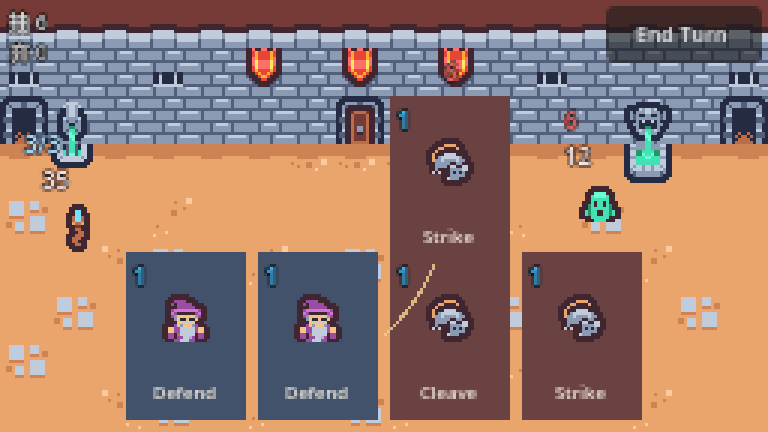 | 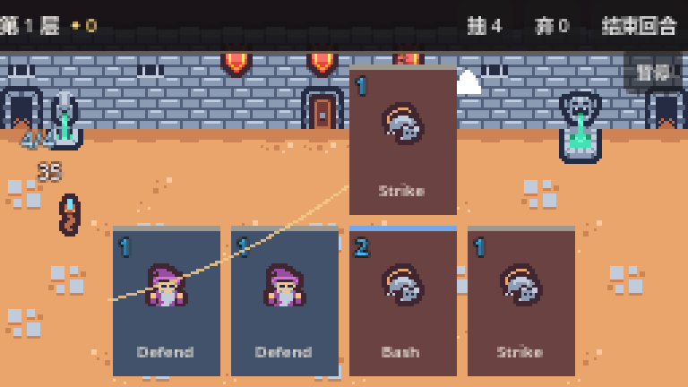 |

> 左：最早的弧线（起点用卡片当前位置，几乎缩成一个点）　右：修好之后（起点改成手牌原位，并加了目标箭头）

## 视频里

抽帧（11:26）看到 `Battle` 的节点树：

```
Battle
├── Background
├── CardDropArea (Area2D)
│   └── CollisionShape2D
├── BattleUI
│   └── Hand
│       ├── CardUI1 / CardUI2 / CardUI3
└── Enemy
    └── Sprite2D
```

字幕：「更好的办法是展开 texture 旁的下拉菜单，点 load」——这一集在给 `Sprite2D` 指定 `arrow.png`，也就是画瞄准指示。

## 我实现了什么

`CardTargetSelector`（`Node2D` + `Line2D`），每帧重画一条二次贝塞尔：

```gdscript
func build_arc(from: Vector2, to: Vector2) -> PackedVector2Array:
	var points := PackedVector2Array()
	var delta := to - from
	var normal := Vector2(-delta.y, delta.x).normalized()
	var bulge := minf(delta.length() * 0.22, 16.0)   # 弧度随距离长，但有上限
	var control := (from + to) * 0.5 + normal * bulge
	for i in SEGMENTS + 1:
		var t := float(i) / SEGMENTS
		var a := from.lerp(control, t)
		var b := control.lerp(to, t)
		points.append(a.lerp(b, t))
	return points
```

## 踩坑与取舍

**坑：弧线画不出来。** 第一版起点用"卡的当前位置"：

```gdscript
var from := card.global_position + card.size * 0.5   # ❌
```

但卡是**跟着鼠标走**的——起点和终点几乎重合，弧线缩成一个点，截图里几乎看不见。改成用"拖出去之前的原位"：

```gdscript
var from := card.home_global_position + card.size * 0.5   # ✅
```

`home_global_position` 在 `dragging.enter()` 里、`reparent` 之前记下。

**取舍：为什么用贝塞尔而不是直线。** 直线会被卡面自己挡住一部分，看不出"从哪出来"；弧线从手牌位置绕出去，视觉上更像"抽出来甩向敌人"。

## 怎么验证

`shots/p10_2_aiming.png`（早期）和 `p10_3_after_strike.png` 里能看到那条米色弧线。

## 与视频的差异

- 视频用 `Area2D` + 箭头贴图；这里用 `Line2D` 画曲线（没有 `arrow.png` 的朝向计算，也就不需要旋转贴图）

---

# P5 · 卡牌瞄准系统：瞄准状态、弧线引导、目标选择器全打通（21:25）

|  |  |
| :---: | :---: |
|  | 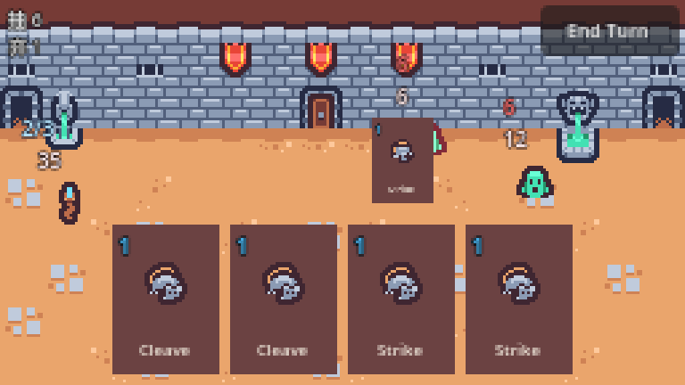 |

> 左：瞄准态——弧线、箭头、被瞄的敌人放大　右：松手后打中敌人

## 视频里（据标题推断）

- 状态机加 `AIMING` 状态
- 拖出「指定目标」的卡就进入瞄准，弧线跟着鼠标
- 松手判定打谁

## 我实现了什么

**进入条件**写在一个 `post_enter()` 里，避免在 `enter()` 里自己切自己被"迟到的请求"规则挡掉：

```gdscript
# card_dragging_state.gd
func post_enter() -> void:
	if card_ui.card and card_ui.card.is_single_targeted():
		transition_requested.emit(self, State.AIMING)
```

**命中判定**用距离，不用碰撞：

```gdscript
const TARGET_RADIUS := 12.0

func targets_under_mouse() -> Array:
	var out: Array = []
	for enemy in get_tree().get_nodes_in_group("enemies"):
		if (enemy as Node2D).global_position.distance_to(mouse_position()) <= TARGET_RADIUS:
			out.append(enemy)
	return out
```

`AIMING` 状态本身只做两件事：让选择器画线、松手转 `RELEASED`。

## 踩坑与取舍

**取舍：为什么用 group 而不是引用。** `get_nodes_in_group("enemies")` 让「谁是敌人」变成运行时约定，卡牌不需要知道敌人管理器在哪。代价是：如果场上敌人很多，这个遍历每帧都会跑（当前最多 2 只，无所谓）。

**半径 12 从哪来**：敌人 sprite 是 16×16、居中绘制，半径 12 大约是"鼠标压在敌人身上 ± 半个身位"，手感上比精确矩形宽容一点。

## 怎么验证

自检打印 `T aim_state=aiming`；截图 `shots/p10_2_aiming.png`。

## 与视频的差异

视频瞄准时会把目标高亮、把卡缩小到角落；这里只做了弧线 + 命中判定，没有高亮描边。

---

# P6 · 用 Cardpile 和 Stats 打造卡牌游戏的数据驱动架构（19:41）

|  |  |
| :---: | :---: |
| 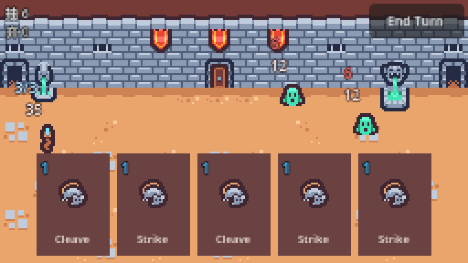 | 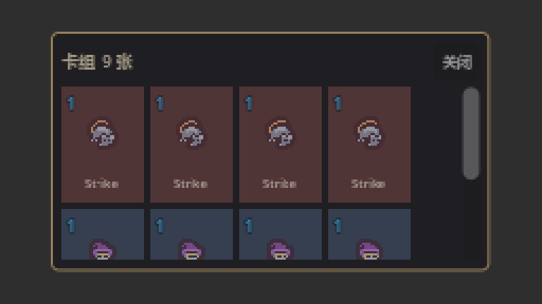 |

> 左：数据层落地后的战斗（玩家 35 血、敌人 18 血）　右：同一批 Card 资源在卡组视图里复用

## 视频里（据标题推断）

把"数据"从"界面"里彻底拆开，全部做成 `Resource`：`Card`、`CardPile`、`Stats`（及其子类）、`Effect`。

## 我实现了什么

```
custom_resources/
├── card.gd            Card：id/type/target/cost/title/icon/tooltip_text/effects
├── card_pile.gd       CardPile：cards[] + draw_card/add_card/shuffle + pile_changed
├── stats.gd           Stats：max_health/health/block + stats_changed
├── character_stats.gd CharacterStats：+ max_energy/energy
├── enemy_stats.gd     EnemyStats：+ display_name/attack_damage/actions
├── effect.gd          Effect 基类：execute(targets)
├── damage_effect.gd   DamageEffect：amount
└── block_effect.gd    BlockEffect：amount
```

**"打给谁"是三态，写在卡上**：

```gdscript
enum Target { SELF, SINGLE_ENEMY, ALL_ENEMIES }

func resolve_targets(selected: Array) -> Array:
	var tree := Engine.get_main_loop() as SceneTree
	match target:
		Target.SELF:         return tree.get_nodes_in_group("player")
		Target.ALL_ENEMIES:  return tree.get_nodes_in_group("enemies")
		_:                   return selected      # 单目标：用玩家瞄的那个
```

**伤害结算放在 Stats 里**（格挡先顶）：

```gdscript
func take_damage(damage: int) -> void:
	if damage <= 0: return
	var absorbed := mini(block, damage)
	block -= absorbed
	health = health - (damage - absorbed)
	stats_changed.emit()
```

## 踩坑与取舍

**坑：类型化数组不兼容。** `Effect.execute(_targets: Array[Node])` 收到的是未类型化的 `Array`，Godot 直接拒绝调用：

```
Invalid type in function 'execute' in base 'Resource (DamageEffect)'.
The array of argument 1 (Array) does not have the same element type as the expected typed array argument.
```

三个 effect 的参数全改成 `Array` 才好。教训：**在 GDScript 里跨层传数组，别用类型化数组**，除非你能保证两端完全一致。

**取舍：数据用代码造，不用 `.tres`。** 视频在编辑器里点出资源文件；我用 `Card.new()` + `CardLibrary`（P21 才抽成工厂）。理由：手写 `.tres` 的 `Array[Effect]` 序列化格式很容易写错（`Array[Resource]([...])` 这种），调试成本高于收益。

## 怎么验证

自检里 `T block=5`（Defend 走 `Target.SELF`）、`T after_cleave hp=[2,8]`（Cleave 走 `Target.ALL_ENEMIES`）——两个分支都跑到了。

## 与视频的差异

- 资源用代码构造（见上）
- `Effect` 是 `Resource` 而不是 `RefCounted`，这样将来能存进 `.tres`

---

# P7 · Stats UI：生命值格挡显示、属性绑定、信号更新（23:46）

|  |  |
| :---: | :---: |
| 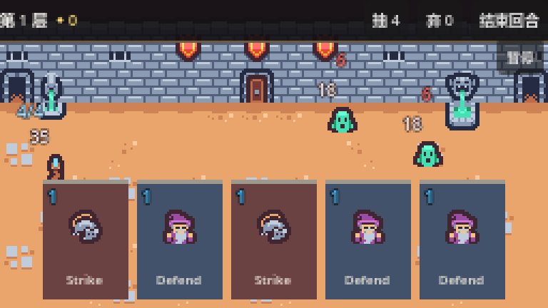 | 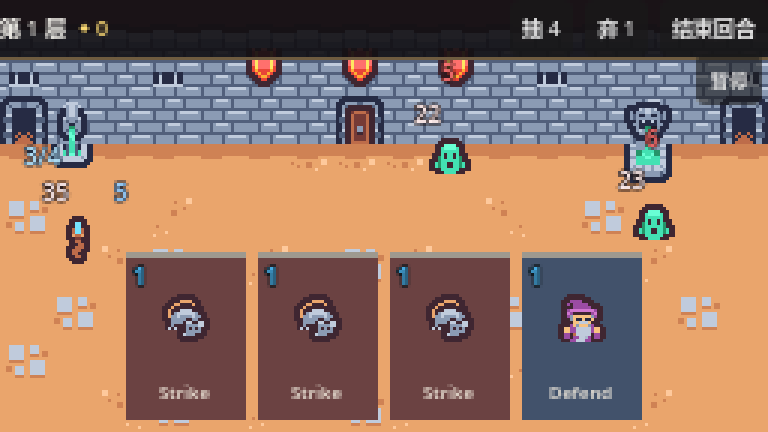 |

> 左：血量、能量、抽/弃计数都在界面上　右：打出一张 Defend 后，格挡 5 出现在玩家脚下

## 视频里

抽帧（9:49）看到 `player.gd` 的原文：

```gdscript
class_name Player
extends Node2D

@export var stats: CharacterStats : set = set_character_stats

@onready var sprite_2d: Sprite2D = $Sprite2D
@onready var stats_ui: StatsUI = $StatsUI as StatsUI

func set_character_stats(value: CharacterStats) -> void:
	stats = value.create_instance()
	if not stats.stats_changed.is_connected(update_stats):
		stats.stats_changed.connect(update_stats)
```

核心思想很清楚：**UI 只订阅，不轮询**。

## 我实现了什么

```gdscript
class_name StatsUI
extends Control

@export var stats: Stats

func bind(new_stats: Stats) -> void:
	if stats and stats.stats_changed.is_connected(_refresh):
		stats.stats_changed.disconnect(_refresh)
	stats = new_stats
	if stats == null: return
	if not stats.stats_changed.is_connected(_refresh):
		stats.stats_changed.connect(_refresh)
	_refresh()

func _refresh() -> void:
	health_label.text = str(stats.health)
	block_label.visible = stats.block > 0     # 没格挡就不显示 "0"
	block_label.text = str(stats.block)
```

`Player` 和 `Enemy` 各自在 `bind_stats()` 里把 stats 交给自己的 `StatsUI`，并额外刷新能量/意图。

## 踩坑与取舍

**取舍：为什么 `bind()` 要先 disconnect。** 同一个 `StatsUI` 可能被复用（敌人被替换、角色重开）。不先断开的话，旧 stats 的信号还连着，一次伤害会触发两次刷新——数字可能瞬间跳两下。

**为什么血量数字带描边**：256×144 下 8px 的字压在墙砖上几乎看不清，`theme_override_constants/outline_size = 2` + 深色描边是唯一可靠的解法。

## 怎么验证

截图 `shots/p10_1_battle.png`：玩家脚下 `35`、敌人头顶 `18`，格挡不为 0 时才出现蓝色数字。

## 与视频的差异

视频里 `StatsUI` 是独立场景并在 `Player` 里 `as StatsUI` 强转；我这里同一个思路，但 `bind()` 额外处理了"重新绑定"。

---

# P8 · 卡牌视觉重构与交互反馈：鼠标过滤、资源驱动 UI 更新（20:02）

|  |  |
| :---: | :---: |
|  | 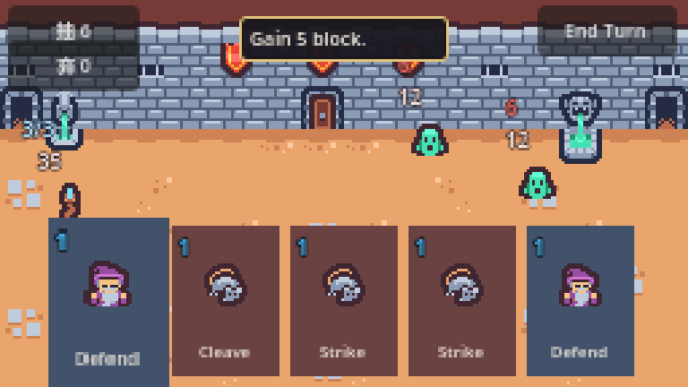 |

> 左：卡面——左上费用、中间图标、底部名字、顶部 2px 色带是稀有度　右：悬停出说明，文字也来自 Card 资源

## 视频里（据标题推断）

- 把 P2 的调试色块换成真卡面：费用、图标、名字，按卡类型给底色
- 处理**鼠标过滤**：卡上的子控件不能抢走卡的输入
- 卡面数值来自 `Card` 资源，不是手填

## 我实现了什么

```
CardUI (Control 40×56)
├── Background (ColorRect)         ← 类型底色
├── Icon (TextureRect 16×16)
├── Cost (Label, 蓝色 + 描边)
├── Title (Label, 底部居中, 6px)
└── CardStateMachine
```

```gdscript
const TYPE_COLORS := {
	Card.Type.ATTACK: Color(0.42, 0.26, 0.26),   # 红棕
	Card.Type.SKILL:  Color(0.26, 0.32, 0.42),   # 蓝灰
	Card.Type.POWER:  Color(0.30, 0.26, 0.42),   # 紫
}

func set_card(new_card: Card) -> void:
	cost_label.text = str(card.cost)
	title_label.text = card.title
	if card.icon: icon.texture = card.icon
	background.color = TYPE_COLORS.get(card.type, ...)
```

**鼠标过滤**：所有子控件 `mouse_filter = 2`（IGNORE），否则 `ColorRect` / `Label` 会吃掉点击，卡的 `_gui_input` 收不到事件、拖不起来。这一条是 P8 标题里点名要处理的东西。

## 踩坑与取舍

**坑：子控件吞输入。** 表现是"卡看得见但拖不动"，很容易误以为是状态机坏了。排查顺序应该是：先确认 `_gui_input` 有没有被调用（加打印），再看子控件的 `mouse_filter`。

**取舍：标题用 6px。** 256 宽的屏幕上一张卡只有 40px 宽，`Strike` 用 8px 会溢出。宁可小一点、能让玩家认出是哪张就行（真正的说明在 P11 的提示框里）。

## 怎么验证

截图 `shots/p10_1_battle.png`：五张卡分别是 Strike/Strike/Cleave/Defend/Strike，费用数字和图标都在。

## 与视频的差异

视频用一个叫 `card_visuals` 的独立子场景 + `StyleBox` 九宫格边框；我用纯色底 + 描边字，少一层节点。

---

# P9 · 法力 UI 与效果：伤害格挡效果、卡牌打出逻辑全实现（20:06）

|  |  |
| :---: | :---: |
|  |  |

> 左：Strike 的伤害生效（敌人掉血）　右：Defend 的格挡生效（玩家 +5）——两张卡走的是同一套 Effect 执行

## 视频里（据标题推断）

- 玩家能量（法力）的 UI 显示
- `DamageEffect` / `BlockEffect` 真正被执行
- 卡牌打出的完整逻辑

> 注：这一集我早期误读成"卡牌特效"，实际标题是**法力 UI 与效果**。受击闪白属于 P17，不在这一集。

## 我实现了什么

**能量显示**在玩家头顶（`player.tscn` 的 `Energy` 标签），并随 `stats_changed` 刷新：

```gdscript
func _refresh_energy() -> void:
	energy_label.text = "%d/%d" % [stats.energy, stats.max_energy]
```

**效果执行**（`Card.apply`）：

```gdscript
func apply(selected: Array) -> void:
	var targets := resolve_targets(selected)
	for effect: Effect in effects:
		effect.execute(targets)
```

**打出逻辑**在 `Battle._on_play_requested`（和 P10 合并实现）：

```gdscript
if not player.spend_energy(card_ui.card.cost):
	card_ui.return_home()          # 能量不够：退回
	return
card_ui.card.apply(targets)        # 执行效果
handler.discard(card_ui)           # 进弃牌堆 + 飞走动画
_refresh_affordability()
```

## 踩坑与取舍

**取舍：效果用"资源数组"而不是"函数名"。** 也可以让卡存一个 `func` 引用，但那样没法存进 `.tres`、也没法在编辑器里看。`Array[Effect]` 的好处是**一张卡能挂多个效果**——`IronWave`（5 伤 + 5 格挡，P21 加的）就是两个 Effect 串起来的，没有改任何执行代码。

## 怎么验证

自检：`T play: hp 18 -> 12`（Strike 6 伤）、`T block=5`（Defend）。

## 与视频的差异

视频有独立的法力球 UI（圆形图标 + 数字）；我这里只有文字 `3/3`，位置在玩家头顶。功能等价，表现弱一档。

---

# P10 · 卡牌打出与禁用系统：法力判断、交互拦截（21:00）

|  |  |
| :---: | :---: |
| 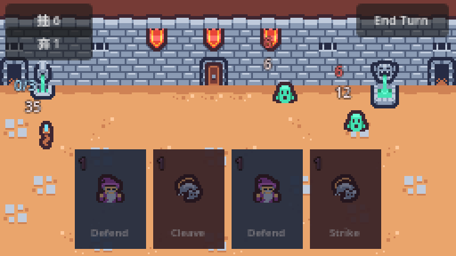 |  |

> 左：能量清零，所有卡压暗、费用变红　右：正常状态，能量 4/4 时卡是亮的

## 视频里（据标题推断）

- 能量不足的卡要"打不出去"，而且操作要被拦住
- 非法操作（没瞄到人、没放在出牌区、能量不够）不能把卡弄丢

## 我实现了什么

三层拦截，每一层都把卡送回原位：

| 场景 | 拦截点 | 行为 |
|---|---|---|
| 单目标卡没瞄到敌人 | `released` 状态 | `_return_home()` |
| 非目标卡没落在出牌区 | `released` 状态 | `_return_home()` |
| 能量不够 | `Battle._on_play_requested` | `card_ui.return_home()` |

```gdscript
## card_ui.gd
func return_home() -> void:
	if original_parent and get_parent() != original_parent:
		reparent(original_parent)
		var last := original_parent.get_child_count() - 1
		original_parent.move_child(self, mini(original_index, last))
	if state_machine.current_state and state_machine.current_state.state != CardState.State.BASE:
		state_machine.transition_to(state_machine.states[CardState.State.BASE])
```

## 踩坑与取舍

**关键约束：任何失败路径都不能让这张卡消失。** 早期版本 `return_home()` 只 reparent 不改状态，卡回去之后还停在 `dragging`（`_process` 还在跑、跟着鼠标走）。所以必须同时把状态机推回 `BASE`。

**为什么拦截放在两处**：`released` 负责"操作合法性"（打给谁），`Battle` 负责"规则合法性"（够不够能量）。前者需要知道鼠标位置，后者需要知道玩家资源——放在一起会让两边互相依赖。

## 怎么验证

自检里的"能量清零后 4 张卡全部变暗"（`T unaffordable=4/4`，P11 加的视觉反馈），以及"没瞄到人自动回手牌"的轨迹可以从 `shots/p3_3_returned.png` 看出来。

## 与视频的差异

视频里"禁用"包含**视觉上的灰色 + 不能拖拽**；我只做了"能拖但打不出去 + 变暗"，没有禁止拖拽。理由是：允许玩家试着拖、然后被打回，反馈比"完全拖不动"更明确。

---

# P11 · 卡牌悬浮提示与交互优化（18:55）

|  |  |
| :---: | :---: |
|  |  |

> 左：悬停提示框（金边）　右：能量不足时的"打不出来"反馈

## 视频里（据标题推断）

悬停显示这张卡干什么；能量不够的卡要有明确反馈。

## 我实现了什么

- `CardTooltip`（`PanelContainer`，挂在 `UILayer` 上，不塞进卡里）
- `set_affordable()`：能量不足时整张压暗、费用变红
- `Battle._refresh_affordability()` 订阅 `stats_changed`，能量一变就重算全部手牌

```gdscript
func set_affordable(value: bool) -> void:
	affordable = value
	modulate = Color(1, 1, 1, 1) if value else Color(0.55, 0.55, 0.6, 0.95)
	cost_label.modulate = Color(1, 1, 1) if value else Color(1.9, 0.55, 0.55)
```

## 踩坑与取舍

**坑 1：`Panel` 默认什么都不画。** 第一版提示框完全看不见——只有文字浮在背景上。`Panel` / `PanelContainer` 没有 `StyleBox` 就是纯透明。加 `StyleBoxFlat`（深色底 + 金色描边）之后才有"盒子"。

**坑 2：提示框跑到屏幕外。** 跟着卡片定位时，`get_combined_minimum_size()` 在第一帧还没算出来（返回 0×0），算出来的位置偏到左上角。256 宽的屏幕上跟着飘本来就容易出界，改成**固定在手牌正上方居中**：

```gdscript
global_position = Vector2(roundf(128.0 - size_now.x * 0.5), 6.0)
```

**坑 3（补了 P3 的旧账）：** 这一集才发现状态机没有转发 `on_mouse_entered/on_mouse_exited`，给状态机补了两个转发、给 `CardState` 补了空实现——P3 的悬停放大到这一刻才真正生效。

## 怎么验证

截图 `shots/p11_tooltip_big.png`：顶部金边提示框显示 `Gain 5 block.`。

## 与视频的差异

视频的提示框跟着卡走、还会带卡牌名字和费用；我固定位置、只显示说明文字。

---

# P12 · 回合管理与抽牌系统：依赖注入、Player Handler、Tween 延迟抽牌（19:07）

|  |  |
| :---: | :---: |
| 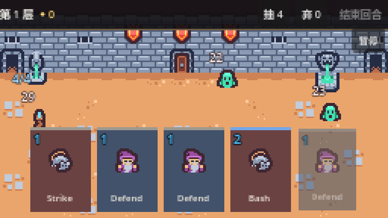 | 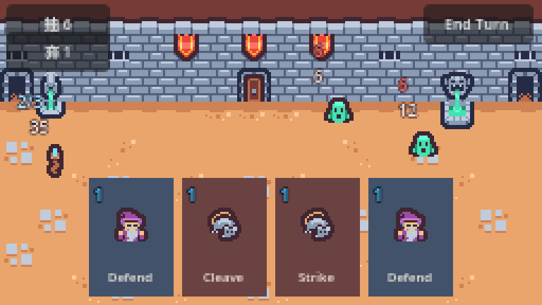 |

> 左：回合开始时一张一张抽（淡入 + 缩放）　右：打出一张后手牌少一张、弃牌堆 +1

## 视频里（据标题推断）

- 把"牌堆 + 抽牌 + 弃牌 + 回合开始"从 `Battle` 里拆出去
- **依赖注入**：handler 由 `Battle` 传入依赖，自己不认识 `Battle`
- 抽牌一张一张出现（Tween 延迟），不是瞬间刷 5 张

## 我实现了什么

```gdscript
class_name PlayerHandler
extends Node

var draw_pile := CardPile.new()
var discard_pile := CardPile.new()

func setup(player_node: Player, hand_node: HBoxContainer, layer: CanvasLayer) -> void:
	player = player_node
	hand = hand_node
	ui_layer = layer

func start_turn() -> void:
	player.start_turn()
	await draw_cards(hand_size)

func draw_cards(amount: int) -> void:
	for i in amount:
		if draw_pile.is_empty():
			reshuffle()
		var card := draw_pile.draw_card()
		if card == null: return
		_spawn(card)                                        # 淡入 + 0.85→1
		if draw_delay > 0.0:
			await get_tree().create_timer(draw_delay).timeout   # ← 延迟抽牌
```

## 踩坑与取舍

**坑：新 `class_name` 不自动注册。** 加完 `PlayerHandler` 后，`Battle` 里写 `var handler: PlayerHandler` 直接解析失败：

```
Parse Error: Could not find type "PlayerHandler" in the current scope.
```

必须跑一次 `--import`，让 `.godot/global_script_class_cache.cfg` 更新。这个坑在 P21–P25 每次新增 `class_name` 时都会重演一遍。

**取舍：用 `create_timer` 而不是 `Tween` 做延迟。** 标题说的是 Tween 延迟抽牌；实际两者都能做，`create_timer + await` 更适合"每张之间等一会儿"这种循环节奏，而 Tween 适合单个属性的补间（入场动画我还是用 Tween）。

## 怎么验证

自检 `T start hand=5 draw=6 discard=0`：11 张牌洗好后抽 5，抽牌堆剩 6。

## 与视频的差异

无实质差异。

---

# P13 · 结束回合与弃牌系统：按钮 UI、弃牌动画、洗牌堆、回合重置（19:45）

|  |  |
| :---: | :---: |
| 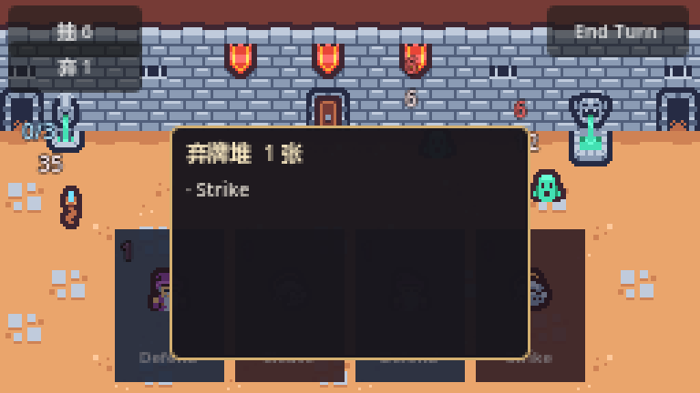 | 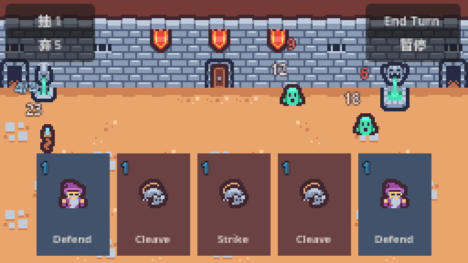 |

> 左：点左上角「弃 N」查看弃牌堆　右：结束回合后敌人依次出手、进入下一轮

## 视频里（据标题推断）

- End Turn 按钮要有可见的禁用状态
- 弃牌要有动画
- 抽牌堆空了要把弃牌堆洗回去
- 回合重置：清格挡、回能量

## 我实现了什么

```gdscript
func end_turn() -> void:
	if enemy_turn or battle_over: return
	enemy_turn = true
	end_turn_button.disabled = true      # 敌人回合期间不允许连点

	handler.discard_hand()

	for enemy in get_tree().get_nodes_in_group("enemies"):
		await enemy.execute(player)
		...
		await get_tree().create_timer(0.22).timeout
		if player.stats.health <= 0:
			_lose(); return

	round_index += 1
	enemy_turn = false
	end_turn_button.disabled = false
	await handler.start_turn()
	_refresh_affordability()
	_pick_intents()
```

**弃牌动画**：

```gdscript
func _animate_to_discard(card_ui: CardUI) -> void:
	if ui_layer and card_ui.get_parent() != ui_layer:
		card_ui.reparent(ui_layer)          # 先脱离 HBoxContainer，否则容器抢位置
	var tween := card_ui.create_tween()
	tween.set_parallel(true)
	tween.tween_property(card_ui, "global_position", discard_point, 0.18)
	tween.tween_property(card_ui, "scale", Vector2(0.35, 0.35), 0.18)
	tween.tween_property(card_ui, "modulate:a", 0.0, 0.18)
	tween.chain().tween_callback(card_ui.queue_free)
```

**牌堆查看**：左上角 `抽 N` / `弃 N` 是 `Button`，点开 `CardPileView` 列出牌名——UI 只读数据。

## 踩坑与取舍

**坑：动画和容器打架（又一次）。** 只要卡还在 `HBoxContainer` 里，容器每帧都会重算布局，`global_position` 的补间会被反复覆盖，看起来像"卡在原地抖"。必须先 `reparent` 到 `UILayer`。

**取舍：`set_parallel(true)` + `chain()`。** 位置、缩放、透明度三个属性同时走；`chain()` 之后再挂"释放"回调，保证动画播完才销毁。

## 怎么验证

自检 `T turn: hand 4 -> 5, draw=1, discard=5`：结束回合弃 4 张 + 打出 1 张 = 5，重抽 5 张。

## 与视频的差异

视频的弃牌动画是"飞向弃牌堆图标并缩小"；我这里飞向左下角的固定点，没有图标可飞（牌堆只有文字按钮）。

---

# P14 · 敌人 AI 与动作系统：条件概率型动作、权重随机、补间攻击动画（23:38）

|  |  |
| :---: | :---: |
| 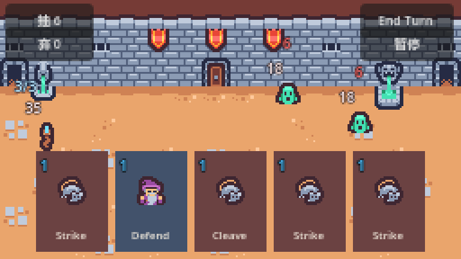 |  |

> 左：玩家回合开始就抽好意图，头顶显示这一回合要打多少　右：敌人回合按意图执行

## 视频里（据标题推断）

敌人不能只会砍一刀：动作要有权重、有触发条件（第几回合），出手要有补间。

## 我实现了什么

**动作是数据**：

```gdscript
class_name EnemyAction
extends Resource

enum Type { ATTACK, BLOCK, BUFF }

@export var type: Type = Type.ATTACK
@export var value := 6
@export var weight := 1.0
@export var min_turn := 0      # 第几回合之后才可能被选中

func label() -> String:
	match type:
		Type.ATTACK: return str(value)
		Type.BLOCK:  return "B%d" % value
		_:           return "▲"
```

**抽签是纯函数式的**：

```gdscript
func pick() -> EnemyAction:
	turn += 1
	var pool: Array[EnemyAction] = []
	var total := 0.0
	for action in actions:
		if action and action.min_turn <= turn and action.weight > 0.0:
			pool.append(action); total += action.weight
	if pool.is_empty(): return null

	var roll := randf() * total
	for action in pool:
		roll -= action.weight
		if roll <= 0.0: return action
	return pool[pool.size() - 1]
```

当前配置：普攻 6 伤（权重 3）、重击 9 伤（权重 1.5，第 2 回合起）、格挡 5（权重 1，第 3 回合起）。

**扑击动画**：

```gdscript
func _lunge(target: Node) -> void:
	var home := position
	var target_pos: Vector2 = (target as Node2D).global_position
	var dir: Vector2 = (target_pos - global_position).normalized()
	var tween := create_tween()
	tween.set_trans(Tween.TRANS_QUAD).set_ease(Tween.EASE_OUT)
	tween.tween_property(self, "position", home + dir * LUNGE_DISTANCE, LUNGE_TIME)
	tween.set_ease(Tween.EASE_IN)
	tween.tween_property(self, "position", home, LUNGE_TIME)
	await tween.finished
```

## 踩坑与取舍

**坑：类型推断失败。**

```gdscript
var dir := (target.global_position - global_position).normalized()   # ❌
```

`target` 声明成 `Node`，取不到 `global_position` 的静态类型，整个脚本解析失败（`Cannot infer the type of "dir"`）。显式标类型才行：`var target_pos: Vector2 = (target as Node2D).global_position`。

**取舍：为什么"条件"写进数据而不是 if。** 视频标题里的"条件概率型动作"，用 `min_turn` 字段就够；如果写成 `if turn >= 3: ...`，每加一个条件就要改 `pick()`，数据驱动的意义就没了。

## 怎么验证

自检：第 1 回合 `T intents=["6","6"]`，第 2 回合 `new_intents=["9","6"]`——重击按 `min_turn=2` 进池了。

## 与视频的差异

视频的动作可能有更多类型（buff、debuff）；我实现了 ATTACK/BLOCK/BUFF 三种枚举，但实际只配置了前两种。

---

# P15 · 敌人 AI 接入与战斗闭环：条件动作、序列执行、胜负判定（23:14）

|  |  |
| :---: | :---: |
|  | 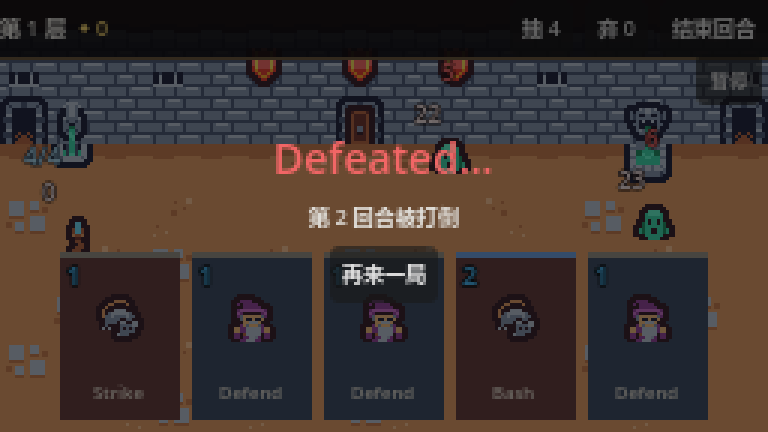 |

> 左：敌人执行完、玩家掉血　右：血被打空时的失败面板

## 视频里（据标题推断）

意图要在玩家回合开始就抽好（玩家能预判），敌人回合逐个执行，打完判胜负。

## 我实现了什么

```gdscript
# 玩家回合开始
func _pick_intents() -> void:
	for enemy in get_tree().get_nodes_in_group("enemies"):
		enemy.pick_intent()

# 结束回合：逐个执行
for enemy in get_tree().get_nodes_in_group("enemies"):
	await enemy.execute(player)
	if enemy.current_action and enemy.current_action.type == EnemyAction.Type.ATTACK:
		Sfx.play("enemy_attack")
		_flash_screen(Color(0.85, 0.12, 0.12, 0.32), 0.22)
		Shaker.shake(3.0, 0.2)
	await get_tree().create_timer(0.22).timeout
	if player.stats.health <= 0:
		_lose(); return
```

**胜负判定挂在信号上**，而不是只在出牌后检查：

```gdscript
enemy.died.connect(_on_enemy_died)

func _on_enemy_died() -> void:
	await get_tree().process_frame    # queue_free 是延迟的，等一帧再数
	_check_victory()
```

## 踩坑与取舍

**坑：胜利判定漏了一条路。** 第一版只在 `_on_play_requested()` 里查敌人是否清空。测试直接给敌人扣血时，面板永远不出现——因为"敌人在别处死掉"这条路（毒、环境伤害、将来的遗物）没有检查点。改成挂 `died` 信号后，无论怎么死都会触发。

**为什么 `await process_frame`**：`queue_free()` 是延迟释放，同一帧内 `get_nodes_in_group("enemies")` 还能数到那只正在死的敌人。不等一帧就会误判"还有敌人"。

## 怎么验证

自检 `T victory: over=true panel=true button=继续前进`。

## 与视频的差异

无实质差异。视频可能有更复杂的"意图执行序列"（一个敌人一回合做多件事）；我这里是"一回合一个动作"。

---

# P16 · 敌人意图系统与手感优化：Intent 资源、UI 显示、代码重构（24:55）

|  |  |
| :---: | :---: |
|  |  |

> 左：意图数字按类型上色（攻击红）　右：同一场战斗的整体界面

## 视频里（据标题推断）

把意图独立成资源 + UI，别再用一句字符串硬编码。

## 我实现了什么

```gdscript
class_name IntentUI
extends Control

const ATTACK_COLOR := Color(1.0, 0.45, 0.45)
const BLOCK_COLOR := Color(0.6, 0.8, 1.0)
const BUFF_COLOR := Color(0.95, 0.85, 0.5)

func show_action(action: EnemyAction) -> void:
	if action == null:
		clear(); return
	label.text = action.label()          # "6" / "B5" / "▲"
	match action.type:
		EnemyAction.Type.ATTACK: label.modulate = ATTACK_COLOR
		EnemyAction.Type.BLOCK:  label.modulate = BLOCK_COLOR
		_:                       label.modulate = BUFF_COLOR
```

`Enemy.pick_intent()` 抽完就把结果推给 `IntentUI`；`execute()` 结束清空。

## 踩坑与取舍

**已知不足（还没修）**：256×144 里，意图数字和血量数字都贴在敌人头顶，敌人靠得近时会挤在一起。解法有三：
1. 意图改成图标（剑/盾）而不是数字
2. 血量挪到脚下、意图留在头顶
3. 敌人之间的最小间距约束

**取舍：意图用 `label()` 生成文本**，而不是各自做一套图标——先保证"能读"，样式后补。

## 怎么验证

截图 `shots/p16_intents_big.png`：两只敌人头顶各有红色 `6`。

## 与视频的差异

视频的意图是图标 + 数字的组合；我这里只有数字 + 颜色。

---

# P17 · 战斗手感打磨：震动、闪白、红屏特效（29:57）

|  |  |
| :---: | :---: |
| 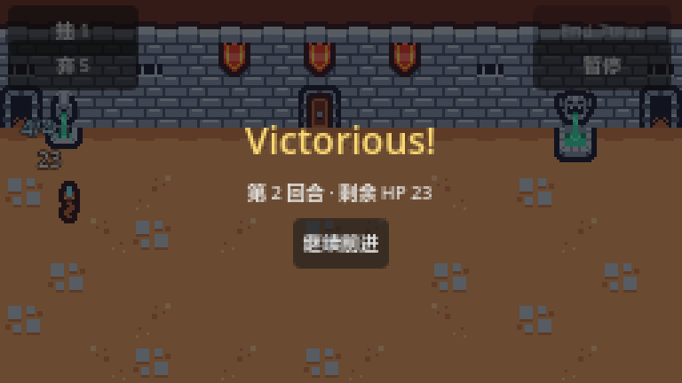 |  |

> 震屏/闪白/红屏都是瞬时效果，静态图抓不到；这两张是它们作用的同一套战斗界面

## 视频里（据标题推断）

打击感靠三样：震屏、受击闪白、受伤红屏。

## 我实现了什么

**震屏**（`global/shaker.gd`，autoload）：

```gdscript
func shake(amount := 3.0, duration := 0.2) -> void:
	if _target == null or not is_instance_valid(_target): return
	if _target.position != _origin:
		_target.position = _origin          # 上一次还没抖完就再来一次，先归位

	var steps := 4
	var tween := create_tween()
	for i in steps:
		var offset := Vector2(randf_range(-amount, amount), randf_range(-amount, amount))
		tween.tween_property(_target, "position", _origin + offset, duration / (steps + 1))
	tween.tween_property(_target, "position", _origin, duration / (steps + 1))
```

**只抖世界层**：`Shaker.register_target(self)` 注册的是 `Battle` 这个 `Node2D`；UI 在 `CanvasLayer` 上不跟着晃。这是故意的——文字跟着抖会糊。

**红屏**：`UILayer/Flash` 是一张整屏 `ColorRect`，改 alpha 做 tween：

```gdscript
func _flash_screen(color: Color, duration: float) -> void:
	flash.color = color
	var tween := create_tween()
	tween.tween_property(flash, "color:a", 0.0, duration)
```

**闪白**：敌人/玩家受击时 `modulate` 拉过曝再回落。

## 踩坑与取舍

**取舍：为什么不用视频里的 `white_sprite_material.gdshader`。** 素材包里确实有那个 shader，但用它意味着每个受击实体都要挂材质、首次使用还要编译。`modulate` 一行就够，效果差一点点。

**震屏的一个细节**：连续挨打（两只敌人连着出手）时，第二次 `shake()` 会在第一次的补间还没结束时启动，起点是"当前随机偏移"而不是原点，越抖越偏。所以开头先归位。

## 怎么验证

截图拍不到震动，但自检日志里能确认这条路径被走到（`T after_enemy_turn` 期间无报错）；手感要自己开窗口试。

## 与视频的差异

见上（shader → modulate）。

---

# P18 · 音效音乐与战斗结算（27:34）

|  |  |
| :---: | :---: |
|  | 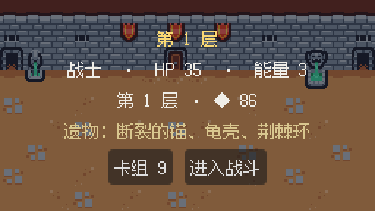 |

> 左：音效挂载的战斗场景　右：Run 中枢（进战斗时会切歌、胜利会播结算音）

## 视频里（据标题推断）

出牌、挨打要有声音；战斗结算要有完整收尾。

## 我实现了什么

```gdscript
extends Node    # autoload: Sfx

const SOUNDS := {
	"slash": "res://art/slash.ogg",
	"block": "res://art/block.ogg",
	"enemy_attack": "res://art/enemy_attack.ogg",
	"enemy_block": "res://art/enemy_block.ogg",
	"axe": "res://art/axe.ogg",
}

func play(sound: String) -> void:
	if not SOUNDS.has(sound): return
	if not _cache.has(sound):
		_cache[sound] = load(SOUNDS[sound])
	var stream: AudioStream = _cache[sound]
	for player in _players:              # 5 个播放器轮转
		if not player.playing:
			player.stream = stream; player.play(); return
	_players[0].stream = stream; _players[0].play()   # 全在忙就抢第一个
```

接的点：攻击牌 → `slash`、技能牌 → `block`、敌人攻击 → `enemy_attack`。

## 踩坑与取舍

**取舍：为什么是播放器池而不是 `AudioStreamPlayer2D`。** 这是 UI 音效，不需要空间化；池化能避免"连续打两张牌时第二张的起音被截断"。

**还没做的**：背景音乐（素材里有 `8_bit_iced_village_lofi.mp3`，13MB）、音量设置；敌人格挡目前没有接 `enemy_block`。

## 怎么验证

声音在无头测试里听不到，只验证了"调用不报错"。需要开窗口自己听。

## 与视频的差异

视频有完整的音乐管理器（淡入淡出、切场景切曲）；我只有一个音效播放器。

---

# P19 · 胜利失败面板 + 游戏暂停与按钮交互完整实现（30:58）

|  |  |  |
| :---: | :---: | :---: |
|  |  | 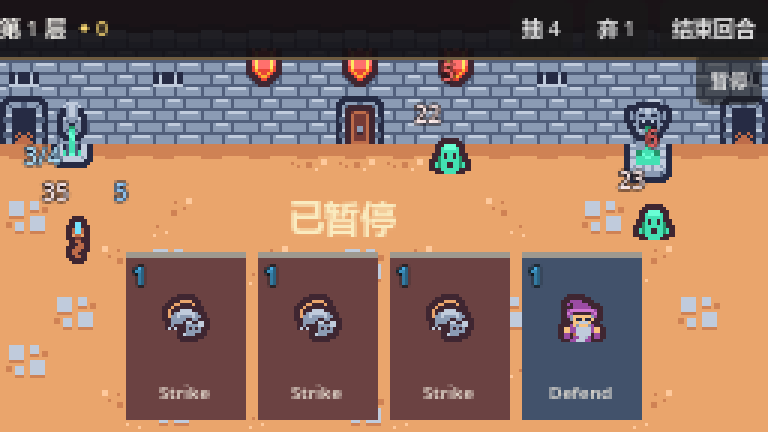 |

> 左：胜利——回合数、剩余 HP、继续前进　中：失败——再来一局　右：暂停

## 视频里（据标题推断）

打赢/打输要有面板、能重开、能暂停。

## 我实现了什么

`BattleOverPanel`：半透明遮罩 + 标题 + 副标题（回合数、剩余 HP）+ 按钮。

```gdscript
func show_result(won: bool, detail := "") -> void:
	visible = true
	_won = won
	title.text = "Victorious!" if won else "Defeated..."
	title.add_theme_color_override("font_color",
		Color(0.98, 0.85, 0.45) if won else Color(0.95, 0.4, 0.4))
	subtitle.text = detail
	restart_button.text = "继续前进" if won else "再来一局"
```

按钮行为随结果变：

```gdscript
restart_button.pressed.connect(func() -> void:
	if _won: continue_requested.emit()     # 赢：回地图（P20）
	else:    restart_requested.emit())     # 输：重载战斗
```

**暂停**：

```gdscript
func _toggle_pause() -> void:
	get_tree().paused = not get_tree().paused
	pause_label.visible = get_tree().paused
```

## 踩坑与取舍

**坑：暂停把自己也冻住。** `get_tree().paused = true` 之后，默认 `PAUSABLE` 的节点全部停止处理——包括暂停按钮自己，于是点不回去。必须：

```gdscript
pause_button.process_mode = Node.PROCESS_MODE_ALWAYS
pause_label.process_mode = Node.PROCESS_MODE_ALWAYS
```

**取舍：暂停不做"暂停菜单"，只冻结画面。** 视频这一集做了完整的暂停菜单（继续/重开/退出）；我先把"冻结 + 提示"跑通，菜单留给后面。

## 怎么验证

自检 `T victory: over=true panel=true button=继续前进`、`T pause=true label=true`；截图 `shots/p19_victory_big.png`。

## 与视频的差异

见上（没有暂停菜单）。

---

# 附录 A · 文件地图（P1–P19 期间产生的全部文件）

| 文件 | 职责 |
|---|---|
| `project.godot` | 视口/窗口/拉伸/最近邻/渲染器；autoload：Sfx、Shaker、RunState |
| `scenes/battle/battle.tscn` `.gd` | 战斗场景与指挥：回合、结算、胜负、手感 |
| `scenes/card_ui/card_ui.tscn` `.gd` | 一张卡的界面与输入入口 |
| `scenes/card_ui/card_state_machine.gd` | 状态机：切换 + 转发 |
| `scenes/card_ui/card_states/card_state.gd` | 状态基类（枚举、信号、空实现） |
| `.../card_base_state.gd` | `base`：悬停、等左键 |
| `.../card_clicked_state.gd` | `clicked`：区分"点一下"和"拖出去" |
| `.../card_dragging_state.gd` | `dragging`：脱离容器、跟鼠标 |
| `.../card_aiming_state.gd` | `aiming`：单目标卡的瞄准态 |
| `.../card_released_state.gd` | `released`：落点判定 → 打出 / 回位 |
| `scenes/card_target_selector/` | 瞄准弧线（Line2D + 贝塞尔） |
| `scenes/ui/hand.tscn` `.gd` | 手牌容器 |
| `scenes/ui/stats_ui.tscn` `.gd` | 血量/格挡显示，订阅 `stats_changed` |
| `scenes/ui/intent_ui.tscn` `.gd` | 敌人意图显示 |
| `scenes/ui/card_tooltip.tscn` `.gd` | 悬浮提示框 |
| `scenes/ui/card_pile_view.tscn` `.gd` | 牌堆查看 |
| `scenes/ui/battle_over_panel.tscn` `.gd` | 胜负面板 |
| `scenes/enemy/enemy.tscn` `.gd` | 敌人：意图、出手、闪白 |
| `scenes/player/player.tscn` `.gd` | 玩家：数值、能量、挨打 |
| `scenes/player/player_handler.gd` | 牌堆 + 抽牌 + 弃牌 + 回合开始 |
| `custom_resources/*.gd` | Card / CardPile / Stats / Effect / EnemyAction / EnemyAI |
| `global/sfx.gd` | 音效池 |
| `global/shaker.gd` | 震屏 |
| `tools/feature_test.gd` `.tscn` | 程序化自检 |

# 附录 B · 怎么跑

```powershell
# 游戏（P25 之后从主菜单进；想直接进战斗用第二行）
& "D:\deepseek工作区\Godot\Godot_v4.7.2-stable_win64.exe" --path "D:\deepseek工作区\deck-builder-game"
& "D:\deepseek工作区\Godot\Godot_v4.7.2-stable_win64.exe" --path "D:\deepseek工作区\deck-builder-game" res://scenes/battle/battle.tscn

# 自检
& "D:\deepseek工作区\Godot\Godot_v4.7.2-stable_win64.exe" --path "D:\deepseek工作区\deck-builder-game" res://tools/feature_test.tscn
```

操作：悬停看提示 → 按住左键拖 → **单目标卡**（Strike）拖到敌人身上松手 → **自身/全体卡**（Defend/Cleave）拖到上半部分松手 → 右上角 `End Turn`。

# 附录 C · 与视频的差异（汇总）

| # | 差异 | 原因 |
|---|---|---|
| 1 | Godot **4.7.2** 而非 4.1/4.3 | 本机版本；工程按 4.7 的 `config/features` 写 |
| 2 | 落点判定用 `Control` 矩形，不用 `Area2D` | 少一次物理查询，256×144 够用 |
| 3 | 卡牌/敌人数据用代码构造，不用 `.tres` | 手写 `Array[Effect]` 序列化易错 |
| 4 | 闪白用 `modulate`，不用 shader | 免材质、免编译 |
| 5 | 敌人/玩家贴图用 Tiny Dungeon 的 tile | 素材包里没有 bat/crab/warrior 立绘 |
| 6 | 悬浮提示固定在手牌上方 | 256px 宽跟着卡片飘会出屏 |
| 7 | 法力只有文字 `3/3`，没有法力球 | 表现层未做 |
| 8 | 意图只有数字 + 颜色，没有图标 | 同上 |
| 9 | P9/P10 合并实现 | 同一段代码，拆开只会来回改 |
| 10 | 没有暂停菜单（只有冻结 + 提示） | 留给后续 |

# 附录 D · 术语对照

| 视频里 | 代码里 | 说明 |
|---|---|---|
| 状态机 | `CardStateMachine` + `CardState` 子类 | 卡牌交互的骨架 |
| 意图 | `EnemyAction` + `IntentUI` | 敌人"下回合要做什么" |
| 数据驱动 | `custom_resources/*.gd` | 用 Resource 描述内容，用代码描述行为 |
| 依赖注入 | `PlayerHandler.setup(player, hand, layer)` | 把依赖传进去，而不是自己去 `get_node` |
| 手感 | `Shaker` + `Flash` + `modulate` | 震屏、红屏、闪白 |
